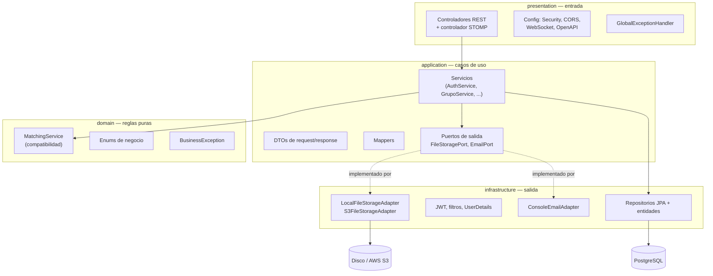
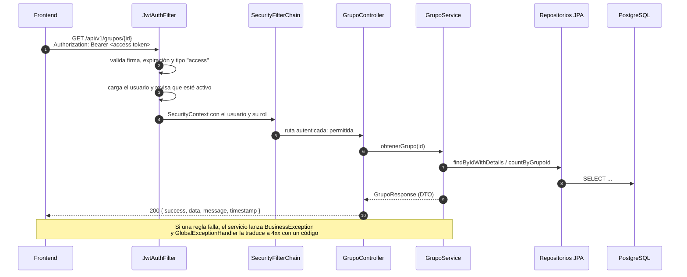
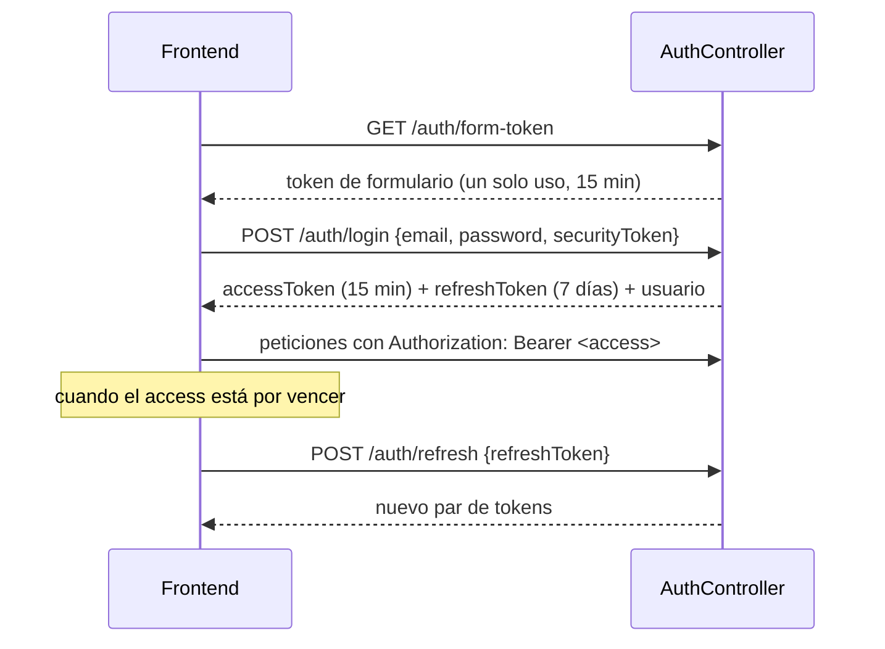
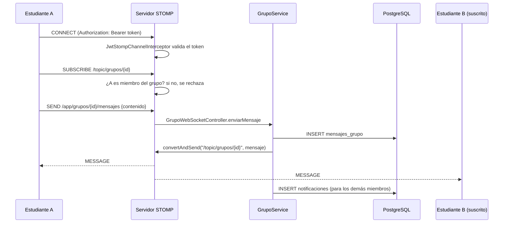
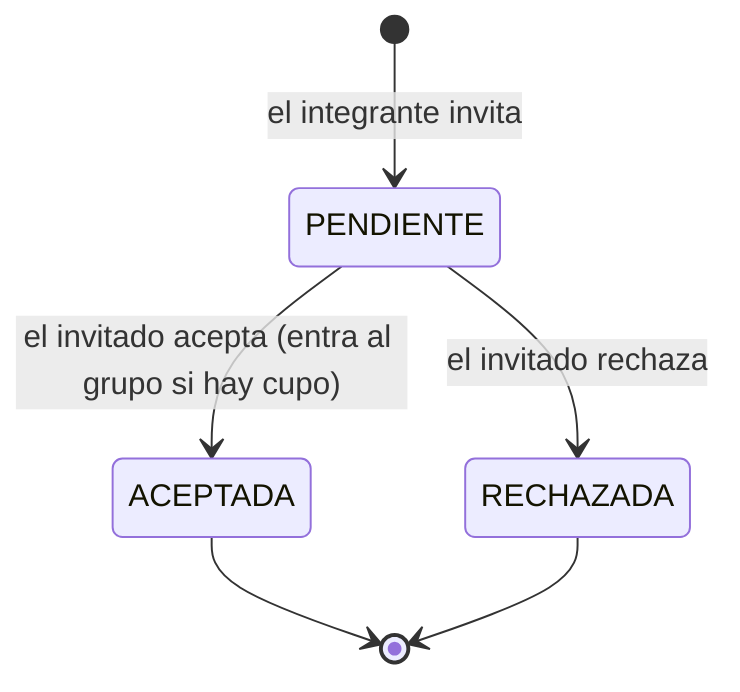

# Duoc Connect — Backend

API REST y servidor de chat en tiempo real de Duoc Connect. Este documento explica **cómo está construido el backend**: arquitectura, patrones de diseño, seguridad, modelo de datos y las lógicas de negocio que requieren explicación. Para levantar el proyecto completo basta Docker; ver el [README principal](../README.md).

## Índice

1. [Resumen técnico](#1-resumen-técnico)
2. [Arquitectura](#2-arquitectura)
3. [Recorrido de una petición](#3-recorrido-de-una-petición)
4. [Patrones de diseño](#4-patrones-de-diseño)
5. [Seguridad](#5-seguridad)
6. [Modelo de datos y migraciones](#6-modelo-de-datos-y-migraciones)
7. [Contrato de la API: respuestas y errores](#7-contrato-de-la-api-respuestas-y-errores)
8. [Lógicas de negocio explicadas](#8-lógicas-de-negocio-explicadas)
9. [Endpoints](#9-endpoints)
10. [Configuración y perfiles](#10-configuración-y-perfiles)
11. [Pruebas y calidad](#11-pruebas-y-calidad)
12. [Estructura de carpetas](#12-estructura-de-carpetas)
13. [Decisiones técnicas y limitaciones conocidas](#13-decisiones-técnicas-y-limitaciones-conocidas)

---

## 1. Resumen técnico

| Aspecto | Tecnología | Versión | Uso |
|---------|------------|---------|-----|
| Lenguaje | Java | 17 | Records, `switch` con expresiones, *pattern matching* de `instanceof` |
| Framework | Spring Boot | 3.3.5 | Web MVC, Data JPA, Security, Validation, WebSocket, Actuator |
| Persistencia | Hibernate (JPA) + PostgreSQL | 6.5 / 16 | ORM y base de datos relacional |
| Migraciones | Flyway | — | Versionado del esquema (V1 a V8) |
| Seguridad | Spring Security + JJWT | 6.3 / 0.12.6 | Autenticación *stateless* con JWT, roles, BCrypt |
| Tiempo real | STOMP sobre WebSocket/SockJS | — | Chat de los grupos de estudio |
| Almacenamiento | Disco local o AWS S3 (SDK v2) | 2.29.52 | Fotos, imágenes del foro y PDF de apuntes |
| Documentación API | springdoc-openapi (Swagger UI) | 2.6.0 | `http://localhost:8080/swagger-ui.html` |
| Utilidades | Lombok | — | Getters/setters, builders, inyección por constructor |
| Pruebas | JUnit 5, Mockito, AssertJ, H2, JaCoCo | — | 140 pruebas unitarias, 70,4 % de líneas cubiertas |

Tamaño: unas **8.600 líneas de Java** en 162 archivos, **11 controladores REST + 1 de WebSocket**, **11 servicios** de aplicación y **19 repositorios**.

---

## 2. Arquitectura

El backend sigue una **arquitectura en capas con puertos y adaptadores** (inspirada en la arquitectura hexagonal). Cada capa tiene una responsabilidad única y solo depende de las capas interiores:



| Capa | Paquete | Qué contiene | Regla |
|------|---------|--------------|-------|
| **Presentación** | `presentation` | Controladores, configuración HTTP/WebSocket, manejador global de errores | No tiene lógica de negocio: valida la entrada (`@Valid`), llama a un servicio y envuelve la respuesta |
| **Aplicación** | `application` | Servicios (casos de uso), DTOs, mappers y **puertos de salida** (interfaces) | Orquesta transacciones (`@Transactional`) y aplica las reglas del negocio |
| **Dominio** | `domain` | `MatchingService`, enums (`RolUsuario`, `EstadoInvitacion`...), excepciones | Lógica pura, sin acceso a base de datos ni a Spring Web |
| **Infraestructura** | `infrastructure` | Entidades y repositorios JPA, seguridad JWT, adaptadores de archivos y correo | Detalles técnicos intercambiables |

**¿Por qué puertos y adaptadores?** Los servicios dependen de interfaces (`FileStoragePort`, `EmailPort`) y no de una tecnología concreta. Así se pudo agregar **AWS S3** sin tocar ningún servicio: basta un nuevo adaptador (`S3FileStorageAdapter`) que implementa el mismo puerto. Lo mismo permitiría cambiar el correo de consola por uno SMTP real.

```java
// application/port/out/FileStoragePort.java — el puerto (lo que el negocio necesita)
public interface FileStoragePort {
    String storeProfilePhoto(MultipartFile file, String previousUrl);
    String storeApuntePdf(MultipartFile file);
    String storeForoImage(MultipartFile file);
    Resource loadAsResource(String fileUrl);
    void deleteStoredFile(String fileUrl);
}
```

---

## 3. Recorrido de una petición

Ejemplo: un estudiante con sesión iniciada consulta un grupo (`GET /api/v1/grupos/{id}`).



Puntos clave:
- **Sin estado (stateless):** el servidor no guarda sesiones. Cada petición trae su JWT.
- **El usuario actual** se obtiene en los servicios desde el `SecurityContext` (`UserPrincipal`), nunca desde un parámetro que envíe el cliente. Así un usuario no puede hacerse pasar por otro.
- **Transacciones:** cada método público de servicio es una transacción (`@Transactional`, o `readOnly = true` en las consultas). Si algo falla, se revierte todo.

---

## 4. Patrones de diseño

| Patrón | Dónde se aplica | Para qué |
|--------|-----------------|----------|
| **Arquitectura en capas / Puertos y adaptadores** | `FileStoragePort` → `LocalFileStorageAdapter` y `S3FileStorageAdapter`; `EmailPort` → `ConsoleEmailAdapter` | Desacoplar el negocio de la tecnología de archivos y correo |
| **Strategy** (elegida por configuración) | `S3FileStorageAdapter` se activa con `@ConditionalOnProperty(app.storage.s3.enabled=true)` y `@Primary` | Cambiar disco ↔ S3 con una variable, sin modificar código |
| **Repository** | 19 interfaces `*JpaRepository` (Spring Data JPA) | Acceso a datos con consultas derivadas, JPQL y SQL nativo |
| **DTO** | `application/dto/request` y `response` | La API nunca expone entidades JPA: controla qué datos salen (por ejemplo, nunca el hash de la contraseña ni el correo de un compañero) |
| **Mapper** | `UsuarioMapper`, `GrupoMapper`, `ApunteMapper`, `CatalogoMapper` | Convertir entidades en DTOs en un solo lugar |
| **Service Layer / Transaction Script** | `application/service` | Un método por caso de uso, con su transacción |
| **Builder** | `@Builder` de Lombok en DTOs (`ApiResponse.builder()...`) | Construir respuestas legibles e inmutables |
| **Inyección de dependencias** | Constructor generado por `@RequiredArgsConstructor` con campos `final` | Dependencias explícitas y fáciles de reemplazar por *mocks* en las pruebas |
| **Chain of Responsibility** | Cadena de filtros de Spring Security + `JwtAuthFilter` | Cada filtro decide y pasa la petición al siguiente |
| **Interceptor** | `JwtStompChannelInterceptor` | Autenticar y autorizar cada trama STOMP del chat |
| **Publish/Subscribe** | Broker STOMP `/topic/grupos/{id}` | Enviar cada mensaje de chat a todos los suscritos del grupo |
| **Manejo centralizado de excepciones** | `@RestControllerAdvice GlobalExceptionHandler` | Un único formato de error para toda la API |
| **Wrapper de respuesta** | `ApiResponse<T>` y `ApiErrorResponse` | Contrato uniforme para el frontend |
| **Inicializador** | `AdminBootstrap implements ApplicationRunner` | Crear el administrador inicial al arrancar, si no existe |
| **Máquina de estados** | `EstadoInvitacion`: `PENDIENTE → ACEPTADA / RECHAZADA` | Una invitación solo se responde una vez |

---

## 5. Seguridad

### 5.1 Autenticación con JWT (access + refresh)



- **Dos tipos de token**, firmados con HMAC-SHA (clave `JWT_SECRET` de al menos 256 bits). El tipo va en el claim `type`, así un *refresh token* robado no sirve para llamar a la API, y un *access token* no sirve para renovar.
- **Contenido del token:** `sub` (correo), `userId`, `type`, `iat` y `exp`. No incluye datos sensibles.
- **`JwtAuthFilter`** (un `OncePerRequestFilter`) valida firma, expiración y tipo; luego **vuelve a cargar al usuario** desde la base. Si un administrador desactiva una cuenta, esa persona **pierde el acceso de inmediato** aunque su token siga vigente.
- **Contraseñas** guardadas con **BCrypt** (hash con sal), nunca en texto plano.

```java
// infrastructure/security/JwtAuthFilter.java (extracto)
if (token != null && jwtTokenProvider.validateToken(token) && jwtTokenProvider.isAccessToken(token)) {
    UserDetails userDetails = loadUser(jwtTokenProvider.extractEmail(token));
    // Un usuario desactivado o eliminado pierde el acceso aunque su token no haya expirado.
    if (userDetails != null && userDetails.isEnabled() && userDetails.isAccountNonLocked()) {
        SecurityContextHolder.getContext().setAuthentication(
            new UsernamePasswordAuthenticationToken(userDetails, null, userDetails.getAuthorities()));
    }
}
```

### 5.2 Autorización

| Nivel | Mecanismo | Ejemplo |
|-------|-----------|---------|
| Ruta pública o privada | `SecurityConfig`: lista `PUBLIC_ENDPOINTS`; todo lo demás exige token | `/api/v1/auth/**` y `/api/v1/catalogos/**` son públicos |
| Rol del sistema | `@PreAuthorize("hasRole('ADMINISTRADOR')")` en `AdminController` | Un estudiante recibe **403** en `/api/v1/admin/**` |
| Reglas del recurso | Validaciones en los servicios | Solo los miembros leen el chat; solo quien creó el grupo o su administrador lo edita; solo el autor de una pregunta acepta una respuesta |

Roles del sistema: `ESTUDIANTE` y `ADMINISTRADOR`. Roles dentro de un grupo: `MIEMBRO` y `ADMIN_GRUPO`.

### 5.3 Otras protecciones

| Protección | Cómo funciona |
|------------|---------------|
| **Token de formulario** (`FormSecurityTokenService`) | Login y registro exigen un token pedido antes a `/auth/form-token`. Es de **un solo uso** y dura **15 minutos**, lo que dificulta automatizar envíos masivos (*scripts* de fuerza bruta) contra esos formularios |
| **Recuperación de contraseña** | Token aleatorio (UUID) de **un solo uso** que vence en **1 hora**. La respuesta es siempre la misma exista o no el correo, para **no revelar qué correos están registrados** |
| **Validación de archivos** | El PDF se valida por tamaño (10 MB), tipo declarado **y firma real del contenido** (los primeros bytes deben ser `%PDF-`). Renombrar un `.exe` a `.pdf` no pasa |
| **Rutas de archivos** | Nombres generados con UUID y normalización de rutas (`normalize()` + `startsWith(uploadRoot)`) para evitar *path traversal* (`../`) |
| **Privacidad de perfiles** | Un perfil oculto responde **404**, no 403, para no confirmar que existe. Las invitaciones directas nunca muestran el correo del compañero |
| **CORS** | Solo el origen configurado (`CORS_ALLOWED_ORIGINS`, por defecto `http://localhost:5173`) |
| **Validación de entrada** | Bean Validation (`@NotBlank`, `@Email`, `@Size`, ...) en los DTOs; los errores vuelven con el detalle por campo |

### 5.4 Seguridad del WebSocket

Las conexiones WebSocket no pasan por los filtros HTTP, por eso existe `JwtStompChannelInterceptor`:

- En **`CONNECT`** exige un *access token* válido en la cabecera `Authorization` de STOMP.
- En **`SUBSCRIBE`** solo permite el destino `/topic/grupos/{uuid}` y **verifica que el usuario sea miembro de ese grupo**. Nadie puede escuchar el chat de un grupo ajeno.
- En cada **`SEND`**, el usuario de la sesión se pone en el `SecurityContext` **en el hilo que ejecuta el handler** (`beforeHandle`) y se quita al terminar (`afterMessageHandled`). Es necesario porque `SecurityContextHolder` guarda el usuario **por hilo**, y Spring procesa las tramas en un *pool* de hilos distinto del de la conexión. Si se pusiera en el hilo equivocado, el servicio no encontraría al usuario; y si no se limpiara, un hilo del *pool* podría quedar con el usuario de otra sesión.

```java
// infrastructure/security/JwtStompChannelInterceptor.java (implementa ExecutorChannelInterceptor)
@Override
public Message<?> beforeHandle(Message<?> message, MessageChannel channel, MessageHandler handler) {
    StompHeaderAccessor accessor = MessageHeaderAccessor.getAccessor(message, StompHeaderAccessor.class);
    if (accessor != null && accessor.getUser() instanceof Authentication authentication) {
        SecurityContextHolder.getContext().setAuthentication(authentication);
    }
    return message;
}

@Override
public void afterMessageHandled(Message<?> message, MessageChannel channel, MessageHandler handler, Exception ex) {
    SecurityContextHolder.clearContext();
}
```

---

## 6. Modelo de datos y migraciones

El modelo completo (diagrama entidad-relación, tablas y justificación de la **tercera forma normal**) está en **[docs/modelo-datos.md](../docs/modelo-datos.md)**.

El esquema **no lo crea Hibernate**: lo versiona **Flyway** y Hibernate solo lo valida (`ddl-auto: validate`). Así el esquema es reproducible y revisable en el repositorio.

| Migración | Contenido |
|-----------|-----------|
| `V1__init_schema.sql` | Esquema inicial (19 tablas): usuarios, catálogos, grupos y chat, apuntes y valoraciones, foro y votos, perfil de compañero; tipos `ENUM` de PostgreSQL |
| `V2__seed_asignaturas.sql` | Catálogo de asignaturas por carrera |
| `V3__expand_catalogos_forum_notifications.sql` | Más sedes, carreras, asignaturas y habilidades; ajustes al foro; tabla `notificaciones` |
| `V4`, `V5`, `V6` | Nuevos tipos de notificación (respuesta en el foro, invitación a grupo, apunte compartido) |
| `V7__normalizacion_3fn.sql` | Normalización a 3FN: elimina dependencias transitivas y agrega restricciones `CHECK`, `UNIQUE` y claves foráneas |
| `V8__invitaciones_directas.sql` | Tabla `invitaciones_directas` y sus notificaciones |

Decisiones relevantes:
- **Claves primarias UUID** (`gen_random_uuid()`): no revelan cuántos registros hay ni permiten adivinar IDs.
- **Claves compuestas** en tablas intermedias (`grupo_miembros`, `usuario_asignaturas`, `valoraciones_apunte`, votos) con `@EmbeddedId`: la base impide duplicados (un voto por persona, una valoración por persona).
- **Contadores desnormalizados a propósito** (`votos`, `descargas`, `promedio_valoracion`, `total_valoraciones`): evitan recalcular con `COUNT`/`AVG` en cada listado. Se actualizan con sentencias atómicas (ver [8.6](#86-apuntes-subida-descarga-y-valoración) y [8.7](#87-foro-votos-sin-duplicados)) y la base valida su rango con `CHECK`.
- **Consultas con `JOIN FETCH`** (`findByIdWithDetails`, `findByEmailWithRelations`) para traer las relaciones en una sola consulta y evitar el problema **N+1**.

---

## 7. Contrato de la API: respuestas y errores

Todas las respuestas exitosas usan el mismo envoltorio `ApiResponse<T>`:

```json
{
  "success": true,
  "data": { "id": "6f1c...", "nombre": "Cálculo I - Repaso" },
  "message": "Operación exitosa",
  "timestamp": "2026-11-23T21:41:58Z"
}
```

Los errores usan `ApiErrorResponse`, con un **código estable** que el frontend puede interpretar:

```json
{
  "success": false,
  "error": {
    "code": "VALIDATION_ERROR",
    "message": "Error de validación",
    "details": [{ "field": "email", "message": "El correo no es válido" }]
  },
  "timestamp": "2026-11-23T21:41:58Z"
}
```

Los servicios lanzan `BusinessException(código, mensaje)` y `GlobalExceptionHandler` decide el estado HTTP según el código:

| HTTP | Códigos |
|------|---------|
| **400** Bad Request | `VALIDATION_ERROR`, `EMAIL_EXISTS`, `FILE_EMPTY`, `FILE_TOO_LARGE`, `FILE_INVALID_TYPE`, `ASIGNATURA_INVALID`, `HORARIO_INVALIDO`, `RESET_TOKEN_INVALID`, `INVALID_SECURITY_TOKEN` |
| **401** Unauthorized | `UNAUTHORIZED` (credenciales), `INVALID_TOKEN`, `TOKEN_EXPIRED`, `USER_INACTIVE` |
| **403** Forbidden | `FORBIDDEN`, `NOT_MEMBER`, `INVALID_CODE`, `GROUP_ADMIN_REQUIRED`, `ACCEPT_FORBIDDEN` |
| **404** Not Found | `NOT_FOUND`, `USER_NOT_FOUND`, `CARRERA_NOT_FOUND`, `ASIGNATURA_NOT_FOUND`, `FILE_NOT_FOUND`, `CODE_NOT_FOUND` |
| **409** Conflict | `ALREADY_MEMBER`, `GROUP_FULL`, `INVITACION_PENDIENTE`, `INVITACION_RESPONDIDA` |
| **500** | `INTERNAL_ERROR` (se registra en el log; al cliente nunca se le muestra el detalle interno) |

---

## 8. Lógicas de negocio explicadas

### 8.1 Algoritmo de compatibilidad entre compañeros (HU-13, HU-14)

`domain/service/MatchingService.java` calcula un puntaje de **0 a 100** entre el estudiante actual y cada candidato. Es lógica de dominio pura (sin base de datos), por eso es fácil de probar.

| Criterio | Peso | Cálculo |
|----------|------|---------|
| Misma carrera | **25** | 25 si coinciden, 0 si no |
| Asignaturas en común | **30** | `comunes / max(asignaturas de A, asignaturas de B) × 30` |
| Horarios compatibles | **25** | `minutos que se solapan el mismo día / max(minutos disponibles de A, de B) × 25` (tope 1) |
| Habilidades complementarias | **20** | `habilidades del candidato que yo NO tengo / habilidades del candidato × 20` |

**Por qué "complementarias" y no "iguales":** en un proyecto conviene un compañero que sepa lo que a mí me falta, así que las habilidades distintas suman más.

**Ejemplo.** Ana y Benja estudian la misma carrera (25 pts). Ana tiene 4 asignaturas y Benja 5, con 3 en común: 3/5 × 30 = **18**. Ana tiene libre el lunes de 10:00 a 12:00 (120 min) y Benja el lunes de 11:00 a 13:00 más el miércoles de 15:00 a 16:00 (180 min); se solapan 60 minutos: 60/180 × 25 = **8,3**. Benja tiene 4 habilidades y 3 no las tiene Ana: 3/4 × 20 = **15**. **Total: 25 + 18 + 8,3 + 15 ≈ 66 %**.

```java
// domain/service/MatchingService.java (extracto)
public int calcularScore(MatchingProfile current, MatchingProfile candidate) {
    double carreraScore = current.carreraId().equals(candidate.carreraId()) ? 25.0 : 0.0;
    Set<UUID> comunes = new HashSet<>(current.asignaturaIds());
    comunes.retainAll(candidate.asignaturaIds());                      // intersección
    int max = Math.max(current.asignaturaIds().size(), candidate.asignaturaIds().size());
    double asignaturaScore = max == 0 ? 0 : (comunes.size() / (double) max) * 30.0;
    double horarioScore  = calcularSolapamientoHorario(current.disponibilidades(), candidate.disponibilidades()) * 25.0;
    double habilidadScore = calcularHabilidadesComplementarias(current.habilidadIds(), candidate.habilidadIds()) * 20.0;
    return (int) Math.round(carreraScore + asignaturaScore + horarioScore + habilidadScore);
}
```

El solapamiento de dos franjas del mismo día es `max(0, min(finA, finB) − max(inicioA, inicioB))` en minutos.

`CompaneroService` arma el `MatchingProfile` de cada candidato, aplica los filtros opcionales (asignatura, habilidad) y **ordena de mayor a menor puntaje**.

### 8.2 Visibilidad del perfil de compañero (HU-21)

Un perfil solo se muestra si se cumplen las tres condiciones: la persona está **activa**, marcó **"busco compañero"**, y su visibilidad lo permite (**`PUBLICO`**, o **`SOLO_CARRERA`** y quien consulta es de su misma carrera). Si no se cumple, se responde **404 "Perfil de compañero no disponible"**, sin dar pistas de si existe.

```java
// application/service/CompaneroService.java
return perfilRepository.findByUsuarioIdWithUsuario(usuarioId)
        .filter(p -> Boolean.TRUE.equals(p.getBuscandoCompanero()))
        .filter(p -> !Boolean.FALSE.equals(p.getUsuario().getActivo()))
        .filter(p -> esVisibleParaUsuario(p, current.getCarrera().getId()))
        .orElseThrow(() -> new EntityNotFoundException("Perfil de compañero no disponible"));
```

### 8.3 Grupos de estudio: códigos, cupo, permisos y salida

- **Código de invitación**: 6 caracteres generados con `SecureRandom` desde el alfabeto `ABCDEFGHJKLMNPQRSTUVWXYZ23456789`, que **excluye `0/O` y `1/I`** para que no se confundan al dictarlos. Se repite el sorteo hasta obtener uno que no exista.
- **Unirse**: se rechaza si ya es miembro (`ALREADY_MEMBER`, 409) o si el grupo llegó a `maxMiembros` (`GROUP_FULL`, 409). Un grupo **privado** exige el código correcto.
- **Editar (HU-19)**: puede quien **creó el grupo** (si sigue siendo integrante) o su **administrador** actual. El cupo nuevo no puede quedar bajo la cantidad de integrantes actuales.
- **Invitar por correo (HU-20)**: solo acepta correos `@duocuc.cl` (expresión regular `^[^@\s]+@duocuc\.cl$`), omite a quienes ya son miembros e informa el resultado de cada correo.
- **Salir del grupo**: si quien sale es el **último integrante, el grupo se elimina**. Si sale el **administrador**, se promueve automáticamente al integrante **más antiguo**, para que el grupo nunca quede sin administrador.

```java
// application/service/GrupoService.java — salirGrupo (extracto)
if (totalMiembros == 1) {                      // último integrante: el grupo deja de existir
    grupoRepository.eliminarGrupo(grupoId);
    return new SalidaGrupoResponse(true, null);
}
boolean esAdmin = membresia.getRol() == RolGrupo.ADMIN_GRUPO;
miembroRepository.delete(membresia);
if (esAdmin) {                                 // traspaso de administración al más antiguo
    GrupoMiembroEntity nuevoAdmin = miembroRepository.findMiembrosOrdenados(grupoId).get(0);
    nuevoAdmin.setRol(RolGrupo.ADMIN_GRUPO);
}
```

### 8.4 Chat en tiempo real

Se usa **STOMP sobre WebSocket** (con **SockJS** como respaldo si el navegador o la red no permiten WebSocket puro) y el *broker* simple en memoria de Spring.



- Cada mensaje **se guarda primero en la base** y después se difunde. El historial no se pierde y se pide paginado con `GET /grupos/{id}/mensajes`.
- Existe también `POST /grupos/{id}/mensajes` (REST) que usa el **mismo** `enviarMensaje`. El frontend lo usa para enviar y como respaldo si el WebSocket se cae.
- Los demás integrantes reciben además una **notificación** `MENSAJE_GRUPO`.

### 8.5 Invitación directa a un compañero (HU-22)

Permite invitar a alguien a un grupo **desde su perfil, sin conocer su correo**. Una invitación es una pequeña **máquina de estados**:



Reglas (`InvitacionDirectaService`):
- Solo se puede invitar a grupos **de los que uno es integrante**, y solo a alguien cuyo perfil de compañero **es visible para quien invita** (reutiliza las reglas de [8.2](#82-visibilidad-del-perfil-de-compañero-hu-21)).
- Impedimentos que se muestran antes de invitar: ya es integrante, ya tiene una invitación **pendiente** a ese grupo, o el grupo está **lleno**. Nadie puede invitarse a sí mismo.
- **El cupo se vuelve a revisar al aceptar**, porque el grupo pudo llenarse mientras la invitación esperaba.
- Al aceptar, entra al grupo **aunque sea privado** (la invitación reemplaza al código).
- Solo la persona invitada ve y responde su invitación; para cualquier otro "no existe" (404). Una invitación ya respondida no se puede volver a responder (`INVITACION_RESPONDIDA`, 409).
- Quien invitó recibe una notificación con la respuesta.

### 8.6 Apuntes: subida, descarga y valoración

**Subida.** Valida que el título exista, que la asignatura pertenezca a la carrera elegida y que el archivo sea un PDF real (tamaño ≤ 10 MB y firma `%PDF-`). Después lo guarda mediante `FileStoragePort`, sin saber si va a disco o a S3.

```java
// infrastructure/storage/LocalFileStorageAdapter.java
/** Revisa la firma "%PDF-" del contenido, no solo lo que declara el cliente. */
private boolean hasPdfSignature(MultipartFile file) {
    byte[] expected = {'%', 'P', 'D', 'F', '-'};
    try (InputStream in = file.getInputStream()) {
        return Arrays.equals(in.readNBytes(expected.length), expected);
    } catch (IOException ex) {
        return false;
    }
}
```

**Descarga.** El PDF siempre pasa por el backend (`GET /apuntes/{id}/descargar`), que exige sesión. El contador se incrementa con una **sentencia atómica en la base**, segura aunque descarguen muchos a la vez:

```java
@Modifying
@Query("UPDATE ApunteEntity a SET a.descargas = a.descargas + 1 WHERE a.id = :id")
int incrementarDescargas(@Param("id") UUID id);
```

**Valoración (1 a 5).** No se puede valorar el propio apunte (`RATING_OWN_NOTE`). Cada persona tiene **una sola** valoración por apunte (clave compuesta apunte + usuario): si vuelve a valorar, se **actualiza** (*upsert*). Luego se recalculan el promedio (2 decimales) y el total desde la tabla de valoraciones.

### 8.7 Foro: votos sin duplicados

Votar es un **interruptor**: el primer clic suma y el segundo quita. Para que sea correcto incluso con clics simultáneos, se apoya en la restricción única de la base con `INSERT ... ON CONFLICT DO NOTHING`:

```java
// application/service/ForoService.java
if (preguntaRepository.insertarVoto(id, usuarioId) == 1) {   // se insertó: no había votado
    preguntaRepository.ajustarVotos(id, 1);
    votado = true;
} else {                                                     // ya existía: se quita el voto
    preguntaRepository.eliminarVoto(id, usuarioId);
    preguntaRepository.ajustarVotos(id, -1);
    votado = false;
}
```

```sql
INSERT INTO votos_pregunta (pregunta_id, usuario_id) VALUES (:id, :usuarioId) ON CONFLICT DO NOTHING
```

Otras reglas: no se puede votar el propio contenido (`VOTE_OWN_CONTENT`) y **solo quien hizo la pregunta puede aceptar una respuesta** como solución (`ACCEPT_FORBIDDEN`, 403). Cuando alguien responde, el autor de la pregunta recibe una notificación.

### 8.8 Almacenamiento de PDF en AWS S3

Es un ejemplo concreto del patrón puertos y adaptadores:

- `S3StorageConfig` crea el cliente de S3 **solo si** `AWS_S3_ENABLED=true`. Usa las claves `AWS_ACCESS_KEY_ID`/`AWS_SECRET_ACCESS_KEY` si están definidas; si no, la cadena estándar de AWS (`~/.aws/credentials`).
- `S3FileStorageAdapter` (marcado `@Primary`) **reemplaza** al adaptador local en todo el sistema, pero solo maneja los **PDF de apuntes**: las fotos y las imágenes del foro las delega al adaptador local.
- Los PDF se suben a un **bucket privado** con cifrado `AES256`. En la base queda la URL `s3://bucket/apuntes/<uuid>.pdf`.
- **Compatibilidad hacia atrás:** si la URL guardada empieza con `/uploads/` (apuntes subidos antes de activar S3), se sigue leyendo desde disco.
- Como la descarga pasa por el backend, el bucket **nunca es público** y se mantiene el control de acceso de la aplicación.

### 8.9 Notificaciones

Las genera el backend cuando ocurre un evento: nuevo mensaje en un grupo, respuesta en el foro, invitación a un grupo (por correo o directa), respuesta a una invitación y apunte compartido. Cada notificación guarda tipo, título, mensaje y un **enlace interno** a la pantalla correspondiente (`/grupos/{id}`, `/foro/{id}`, `/invitaciones`...). El frontend consulta el contador de no leídas cada 30 segundos.

### 8.10 Administrador inicial

`AdminBootstrap` se ejecuta al arrancar (salvo en el perfil `test`). Si no existe el usuario `ADMIN_EMAIL`, lo crea con rol `ADMINISTRADOR` y la contraseña `ADMIN_PASSWORD`. En producción no hay contraseña por defecto: si falta la variable, **no se crea** y se deja una advertencia en el log.

---

## 9. Endpoints

La documentación interactiva completa está en **Swagger UI**: `http://localhost:8080/swagger-ui.html` (JSON en `/api-docs`). Resumen por controlador:

| Controlador | Ruta base | Endpoints | Funcionalidad |
|-------------|-----------|-----------|---------------|
| `AuthController` | `/api/v1/auth` | 6 | Token de formulario, registro, login, refresh, olvidé y restablecer contraseña |
| `UsuarioController` | `/api/v1/usuarios` | 4 | Mi perfil, editarlo, subir foto, perfil público |
| `GrupoController` | `/api/v1/grupos` | 11 | Buscar, crear, editar, invitar por correo, unirse (directo o por código), salir, miembros, mensajes |
| `GrupoWebSocketController` | STOMP `/app/grupos/{id}/mensajes` | 1 | Enviar mensaje de chat |
| `ApunteController` | `/api/v1/apuntes` | 6 | Buscar, subir PDF, detalle, descargar, compartir por correo, valorar |
| `ForoController` | `/api/v1/foro` | 7 | Preguntas (con imagen), respuestas, votos, aceptar solución |
| `CompaneroController` | `/api/v1/companeros` | 5 | Mi perfil de compañero, editarlo, perfil de otro, recomendaciones, búsqueda |
| `InvitacionDirectaController` | `/api/v1` | 5 | Grupos a los que puedo invitar, invitar, mis invitaciones, aceptar, rechazar |
| `NotificacionController` | `/api/v1/notificaciones` | 4 | Listar, contar no leídas, marcar una o todas como leídas |
| `StatusController` | `/api/v1` | 5 | Estado de la app y catálogos (carreras, sedes, asignaturas, habilidades) |
| `AdminController` | `/api/v1/admin` | 29 | Estadísticas, usuarios (rol y estado) y moderación de apuntes, foro, grupos, mensajes, fotos y perfiles |

El detalle de cada ruta también está en la sección **API** del [README principal](../README.md#api).

---

## 10. Configuración y perfiles

| Perfil | Cuándo | Particularidades |
|--------|--------|------------------|
| `dev` (por defecto) | Desarrollo y Docker | Logs SQL, admin de demo (`Admin1234`), lee el `.env` y el `.env.local` de la raíz |
| `prod` | Despliegue | Sin valores por defecto: si falta `JWT_SECRET` no arranca; sin detalles en `/actuator/health` |
| `test` | Pruebas | Base H2 en memoria, sin Flyway y sin `AdminBootstrap` |

Propiedades principales (`src/main/resources/application.yml`):

| Propiedad | Variable | Descripción |
|-----------|----------|-------------|
| `spring.datasource.url` | `SPRING_DATASOURCE_URL` | Conexión a PostgreSQL |
| `app.jwt.secret` | `JWT_SECRET` | Clave de firma de los JWT |
| `app.jwt.access-expiration-ms` / `refresh-expiration-ms` | `JWT_ACCESS_EXPIRATION_MS` / `JWT_REFRESH_EXPIRATION_MS` | 15 minutos / 7 días |
| `app.cors.allowed-origins` | `CORS_ALLOWED_ORIGINS` | Orígenes permitidos (HTTP y WebSocket) |
| `app.upload.path` | `UPLOAD_PATH` | Carpeta de archivos en disco |
| `app.storage.s3.*` | `AWS_S3_ENABLED`, `AWS_S3_BUCKET`, `AWS_REGION`, `AWS_ACCESS_KEY_ID`, `AWS_SECRET_ACCESS_KEY` | Almacenamiento de PDF en S3 |
| `spring.servlet.multipart.max-file-size` | — | 11 MB, algo sobre el límite de 10 MB para que responda el mensaje propio de la validación |

---

## 11. Pruebas y calidad

**140 pruebas unitarias** (JUnit 5 + Mockito + AssertJ). Los servicios se prueban **aislados**: los repositorios y puertos se reemplazan por *mocks*, así cada prueba verifica solo una regla de negocio y corre en milisegundos.

| Clase de prueba | Pruebas | Qué cubre |
|-----------------|---------|-----------|
| `AdminServiceTest` | 23 | Estadísticas, roles, activar/desactivar cuentas, moderación |
| `AuthServiceTest` | 14 | Registro, login, refresh, token de formulario, recuperación de contraseña |
| `InvitacionDirectaServiceTest` | 14 | Impedimentos, cupo al aceptar, estados, privacidad |
| `InfraestructuraTest` | 14 | JWT, filtros, manejo de errores, almacenamiento local |
| `GrupoServiceTest` | 12 | Crear, unirse, cupo, privados, editar, salir y traspaso de administración |
| `UsuarioNotificacionCatalogoServiceTest` | 11 | Perfil, notificaciones, catálogos |
| `CompaneroServiceTest` | 10 | Perfil de compañero, visibilidad, filtros, orden por compatibilidad |
| `ForoServiceTest` | 10 | Preguntas, respuestas, votos y aceptar solución |
| `S3FileStorageAdapterTest` | 7 | Subida, descarga, borrado en S3 y compatibilidad con archivos en disco |
| `JwtStompChannelInterceptorTest` | 5 | Autenticación del CONNECT, suscripción solo a grupos propios y usuario disponible en el hilo del handler |
| `ApunteServiceTest` | 5 | Subida, valoración y sus restricciones |
| `MatchingServiceTest` | 5 | Cálculo del puntaje de compatibilidad |
| `DuocConnectApplicationTests` | 1 | El contexto de Spring arranca con H2 |

- **Cobertura:** JaCoCo genera `target/site/jacoco/index.html` (**70,4 % de líneas**).
- **Integración continua:** GitHub Actions ejecuta las pruebas en cada *push* y *pull request* y publica el resumen de cobertura (`.github/workflows/ci.yml`).
- Para ejecutarlas sin instalar Java ni Maven, desde la raíz del repo:

  ```bash
  docker run --rm -v "${PWD}/backend:/app" -w /app maven:3.9-eclipse-temurin-17 mvn test
  ```

---

## 12. Estructura de carpetas

```
backend/
├── Dockerfile                      # build en 2 etapas: Maven compila, JRE ejecuta
├── pom.xml
└── src/
    ├── main/
    │   ├── java/cl/duoc/connect/
    │   │   ├── DuocConnectApplication.java
    │   │   ├── presentation/
    │   │   │   ├── controller/      # 11 REST + GrupoWebSocketController
    │   │   │   ├── config/          # SecurityConfig, CorsConfig, WebSocketConfig, OpenApiConfig...
    │   │   │   └── exception/       # GlobalExceptionHandler
    │   │   ├── application/
    │   │   │   ├── service/         # casos de uso
    │   │   │   ├── dto/request|response/
    │   │   │   ├── mapper/
    │   │   │   └── port/out/        # FileStoragePort, EmailPort
    │   │   ├── domain/
    │   │   │   ├── service/         # MatchingService
    │   │   │   ├── enums/
    │   │   │   └── exception/
    │   │   └── infrastructure/
    │   │       ├── persistence/entity|repository/
    │   │       ├── security/        # JWT, filtros, interceptor STOMP
    │   │       ├── storage/         # disco local y AWS S3
    │   │       ├── email/           # ConsoleEmailAdapter
    │   │       └── config/          # AdminBootstrap, JwtProperties
    │   └── resources/
    │       ├── application.yml, application-dev.yml, application-prod.yml
    │       └── db/migration/        # V1 a V8 (Flyway)
    └── test/                        # 140 pruebas unitarias
```

---

## 13. Decisiones técnicas y limitaciones conocidas

| Decisión | Motivo |
|----------|--------|
| JWT *stateless* en vez de sesiones | Escala sin compartir sesiones entre servidores y encaja con una SPA |
| Flyway en vez de `ddl-auto: update` | Esquema versionado, revisable y reproducible en cualquier equipo |
| DTOs en vez de exponer entidades | Control de qué datos salen y desacople entre la API y la base |
| Descarga de PDF a través del backend | Mantiene la autorización de la app y permite un bucket S3 privado |
| Contadores desnormalizados | Listados rápidos sin `COUNT`/`AVG` por fila; se actualizan de forma atómica |

Limitaciones actuales, pensando en un despliegue con varias instancias:

- **El correo es simulado:** `ConsoleEmailAdapter` escribe en el log los enlaces de recuperación e invitación. Para enviar correos reales basta otro adaptador de `EmailPort` (por ejemplo SMTP o Amazon SES).
- **Estado en memoria:** los tokens de formulario y el *broker* STOMP viven en la memoria del proceso. Con varias instancias habría que moverlos a Redis o usar un *broker* externo (RabbitMQ).
- **Sin revocación de refresh tokens:** se invalidan al vencer o al desactivar la cuenta, pero no hay una lista negra para cerrar sesión en todos los dispositivos.
