# Modelo de datos de Duoc Connect

Base de datos **PostgreSQL 16**. El esquema se versiona con **Flyway** (`backend/src/main/resources/db/migration`, V1 a V7) y se crea solo al iniciar el backend.

**Resumen para la defensa:** el modelo está en **tercera forma normal (3FN)**. Lo único que se guarda ya calculado son algunos contadores (votos, valoraciones y descargas). Es una desnormalización controlada que se hace a propósito por rendimiento, y la base valida su rango con restricciones `CHECK`.

## 1. Diagrama entidad-relación

GitHub dibuja este diagrama automáticamente. Para usarlo en una presentación, está exportado como imagen en [modelo-er.svg](modelo-er.svg).

```mermaid
erDiagram
    CARRERAS ||--o{ ASIGNATURAS : "tiene"
    CARRERAS ||--o{ USUARIOS : "estudia"
    SEDES ||--o{ USUARIOS : "pertenece"

    USUARIOS ||--o| PERFILES_PROYECTO : "perfil de compañero"
    USUARIOS ||--o{ USUARIO_ASIGNATURAS : ""
    ASIGNATURAS ||--o{ USUARIO_ASIGNATURAS : ""
    USUARIOS ||--o{ USUARIO_HABILIDADES : ""
    HABILIDADES ||--o{ USUARIO_HABILIDADES : ""
    USUARIOS ||--o{ DISPONIBILIDADES : "horarios"
    USUARIOS ||--o{ PASSWORD_RESET_TOKENS : ""
    USUARIOS ||--o{ NOTIFICACIONES : "recibe"

    USUARIOS ||--o{ GRUPOS_ESTUDIO : "crea"
    CARRERAS ||--o{ GRUPOS_ESTUDIO : ""
    ASIGNATURAS |o--o{ GRUPOS_ESTUDIO : "opcional"
    GRUPOS_ESTUDIO ||--o{ GRUPO_MIEMBROS : ""
    USUARIOS ||--o{ GRUPO_MIEMBROS : ""
    GRUPOS_ESTUDIO ||--o{ MENSAJES_GRUPO : "chat"
    USUARIOS ||--o{ MENSAJES_GRUPO : "escribe"

    USUARIOS ||--o{ APUNTES : "sube"
    ASIGNATURAS ||--o{ APUNTES : ""
    APUNTES ||--o{ VALORACIONES_APUNTE : ""
    USUARIOS ||--o{ VALORACIONES_APUNTE : "valora"

    USUARIOS ||--o{ PREGUNTAS : "pregunta"
    CARRERAS ||--o{ PREGUNTAS : ""
    ASIGNATURAS |o--o{ PREGUNTAS : "opcional"
    PREGUNTAS ||--o{ RESPUESTAS : ""
    USUARIOS ||--o{ RESPUESTAS : "responde"
    PREGUNTAS ||--o{ VOTOS_PREGUNTA : ""
    RESPUESTAS ||--o{ VOTOS_RESPUESTA : ""
    USUARIOS ||--o{ VOTOS_PREGUNTA : "vota"
    USUARIOS ||--o{ VOTOS_RESPUESTA : "vota"

    CARRERAS {
        uuid id PK
        varchar nombre UK
        varchar codigo UK
    }
    SEDES {
        uuid id PK
        varchar nombre UK
        varchar ciudad
    }
    ASIGNATURAS {
        uuid id PK
        varchar nombre
        varchar codigo
        uuid carrera_id FK
    }
    HABILIDADES {
        uuid id PK
        varchar nombre UK
    }
    USUARIOS {
        uuid id PK
        varchar email UK
        varchar password_hash
        varchar nombre
        uuid carrera_id FK
        uuid sede_id FK
        smallint semestre
        rol_usuario rol
        boolean activo
    }
    PERFILES_PROYECTO {
        uuid usuario_id PK, FK
        boolean buscando_companero
        text bio
        visibilidad_perfil visibilidad
    }
    USUARIO_ASIGNATURAS {
        uuid usuario_id PK, FK
        uuid asignatura_id PK, FK
    }
    USUARIO_HABILIDADES {
        uuid usuario_id PK, FK
        uuid habilidad_id PK, FK
        nivel_habilidad nivel
    }
    DISPONIBILIDADES {
        uuid id PK
        uuid usuario_id FK
        smallint dia_semana
        time hora_inicio
        time hora_fin
    }
    GRUPOS_ESTUDIO {
        uuid id PK
        varchar nombre
        uuid carrera_id FK
        uuid asignatura_id FK
        uuid creador_id FK
        smallint max_miembros
        boolean privado
        varchar codigo_invitacion UK
    }
    GRUPO_MIEMBROS {
        uuid grupo_id PK, FK
        uuid usuario_id PK, FK
        rol_grupo rol
    }
    MENSAJES_GRUPO {
        uuid id PK
        uuid grupo_id FK
        uuid usuario_id FK
        text contenido
    }
    APUNTES {
        uuid id PK
        varchar titulo
        uuid usuario_id FK
        uuid asignatura_id FK
        varchar archivo_url
        int descargas
        numeric promedio_valoracion
        int total_valoraciones
    }
    VALORACIONES_APUNTE {
        uuid apunte_id PK, FK
        uuid usuario_id PK, FK
        smallint puntuacion
    }
    PREGUNTAS {
        uuid id PK
        varchar titulo
        text contenido
        uuid usuario_id FK
        uuid carrera_id FK
        uuid asignatura_id FK
        int votos
    }
    RESPUESTAS {
        uuid id PK
        uuid pregunta_id FK
        uuid usuario_id FK
        text contenido
        int votos
        boolean aceptada
    }
    VOTOS_PREGUNTA {
        uuid pregunta_id PK, FK
        uuid usuario_id PK, FK
    }
    VOTOS_RESPUESTA {
        uuid respuesta_id PK, FK
        uuid usuario_id PK, FK
    }
    NOTIFICACIONES {
        uuid id PK
        uuid usuario_id FK
        tipo_notificacion tipo
        varchar titulo
        boolean leida
    }
    PASSWORD_RESET_TOKENS {
        uuid id PK
        uuid usuario_id FK
        varchar token UK
        timestamptz expira_en
        boolean usado
    }
```

## 2. Tablas

| Grupo | Tablas | Propósito |
|---|---|---|
| Catálogos | `carreras`, `sedes`, `asignaturas`, `habilidades` | Datos de referencia que el resto de las tablas usa por clave foránea. |
| Usuarios | `usuarios`, `password_reset_tokens`, `notificaciones` | Cuenta, rol (estudiante o administrador), recuperación de contraseña y avisos in-app. |
| Compañeros (HU-13/14) | `perfiles_proyecto`, `usuario_asignaturas`, `usuario_habilidades`, `disponibilidades` | Perfil para buscar compañeros y calcular la compatibilidad. |
| Grupos | `grupos_estudio`, `grupo_miembros`, `mensajes_grupo` | Grupos de estudio, integrantes con su rol y chat. |
| Apuntes | `apuntes`, `valoraciones_apunte` | Banco de apuntes en PDF y valoraciones de 1 a 5. |
| Foro | `preguntas`, `respuestas`, `votos_pregunta`, `votos_respuesta` | Preguntas, respuestas, respuesta aceptada y votos. |

Los valores cerrados se guardan como tipos `ENUM` de PostgreSQL: `rol_usuario`, `rol_grupo`, `nivel_habilidad`, `visibilidad_perfil` y `tipo_notificacion`.

## 3. Normalización

### Primera forma normal (1FN)
- Todos los atributos son atómicos y todas las tablas tienen clave primaria.
- Ningún dato se guarda como lista dentro de una columna. Las asignaturas y habilidades de un usuario, sus horarios, los miembros de un grupo y los votos van en tablas propias, con una fila por elemento.

### Segunda forma normal (2FN)
- Las tablas con clave compuesta son `grupo_miembros`, `valoraciones_apunte`, `votos_pregunta`, `votos_respuesta`, `usuario_asignaturas` y `usuario_habilidades`. En ellas, los atributos que no son clave (`rol`, `puntuacion`, `nivel`, `joined_at`) dependen de la clave **completa**. Por ejemplo, el nivel depende del par (usuario, habilidad), no solo del usuario.
- El resto de las tablas tiene clave simple (UUID), así que cumple la 2FN de forma directa.

### Tercera forma normal (3FN)
Ningún atributo que no sea clave depende de otro atributo que tampoco lo sea:
- Los nombres de carrera, sede, asignatura y habilidad viven solo en su catálogo. Las demás tablas guardan únicamente el `id`.
- **`apuntes` no guarda `carrera_id`.** Como la asignatura es obligatoria, la carrera se obtiene siempre con `apuntes → asignaturas → carreras` (se eliminó en la V7).
- **`preguntas` no guarda `tematica_general`.** Una pregunta es de temática general cuando `asignatura_id IS NULL` (se eliminó en la V7).
- `preguntas` y `grupos_estudio` sí guardan `carrera_id`, porque su asignatura es **opcional**: una pregunta general o un grupo sin asignatura igual pertenecen a una carrera. Cuando sí hay asignatura, la clave foránea compuesta `(asignatura_id, carrera_id) → asignaturas(id, carrera_id)` obliga a que la carrera coincida. Así la base no puede guardar datos contradictorios.

### Desnormalización controlada (decisión de diseño)
| Columna | Se podría calcular desde | Por qué se guarda | Cómo se protege |
|---|---|---|---|
| `apuntes.promedio_valoracion`, `apuntes.total_valoraciones` | `valoraciones_apunte` | El listado de apuntes muestra y ordena por valoración. Calcularla en cada consulta obligaría a agregar todas las valoraciones. | Se recalcula en la misma transacción en que se valora. `CHECK` de rango (0 a 5, ≥ 0). |
| `preguntas.votos`, `respuestas.votos` | `votos_pregunta`, `votos_respuesta` | El foro ordena por votos. | Se actualiza en la misma transacción del voto. `CHECK (votos >= 0)`. La tabla de votos impide votar dos veces (PK compuesta). |
| `apuntes.descargas` | (no se deriva de otra tabla) | Contador simple. | `CHECK (descargas >= 0)`. |

## 4. Reglas de integridad en la base

- **Claves foráneas** en todas las relaciones, con `ON DELETE CASCADE` donde el hijo no tiene sentido sin el padre: miembros, mensajes, votos, valoraciones, perfil y notificaciones.
- **Únicos:** `usuarios.email`, `carreras.codigo`, `carreras.nombre`, `sedes.nombre`, `habilidades.nombre`, `grupos_estudio.codigo_invitacion`, `password_reset_tokens.token` y `(asignaturas.codigo, carrera_id)`.
- **Una sola respuesta aceptada por pregunta:** índice único parcial `uq_respuesta_aceptada_por_pregunta ON respuestas(pregunta_id) WHERE aceptada`.
- **Coherencia carrera-asignatura:** claves foráneas compuestas `fk_preguntas_asignatura_carrera` y `fk_grupos_asignatura_carrera`.
- **Reglas de dominio (CHECK):** semestre de 1 a 12, máximo de miembros de 2 a 50, puntuación de 1 a 5, día de la semana de 0 a 6, `hora_fin > hora_inicio` y contadores no negativos.
- **Índices** en las claves foráneas más consultadas: carrera y sede del usuario, asignatura del apunte, pregunta de cada respuesta, mensajes por grupo y fecha, notificaciones por usuario, entre otros.

## 5. Historial de migraciones

| Versión | Cambio |
|---|---|
| V1 | Esquema inicial (usuarios, catálogos, grupos, apuntes, foro y perfil de compañero). |
| V2 | Asignaturas de ejemplo por carrera. |
| V3 | Más sedes, carreras, habilidades y asignaturas; foro con temática general e imagen; notificaciones. |
| V4 | Notificación por respuesta en el foro. |
| V5 | Notificación por invitación a un grupo. |
| V6 | Notificación por apunte compartido. |
| V7 | Normalización a 3FN: quita `apuntes.carrera_id` y `preguntas.tematica_general`; agrega FK compuestas, una sola respuesta aceptada, nombres únicos en catálogos, CHECK de contadores e índices. |
