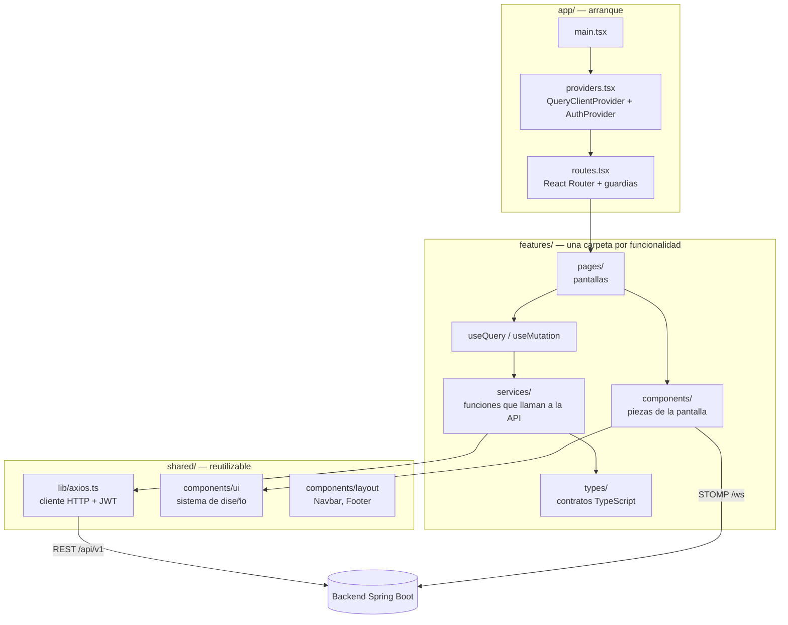
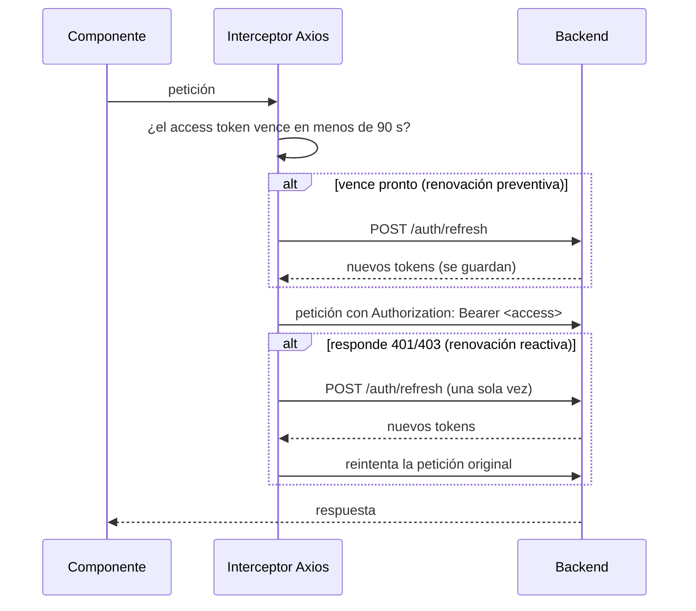

# Duoc Connect — Frontend

Aplicación web de una sola página (SPA) de Duoc Connect. Este documento explica **cómo está construido el frontend**: arquitectura, organización del código, patrones, manejo de la sesión, comunicación con el backend y las lógicas que requieren explicación. Para levantar el proyecto completo basta Docker; ver el [README principal](../README.md). La API que consume está documentada en el [README del backend](../backend/README.md).

## Índice

1. [Resumen técnico](#1-resumen-técnico)
2. [Arquitectura](#2-arquitectura)
3. [Organización por funcionalidades](#3-organización-por-funcionalidades)
4. [Patrones y convenciones](#4-patrones-y-convenciones)
5. [Sesión y autenticación](#5-sesión-y-autenticación)
6. [Rutas y protección de pantallas](#6-rutas-y-protección-de-pantallas)
7. [Datos del servidor con React Query](#7-datos-del-servidor-con-react-query)
8. [Lógicas explicadas](#8-lógicas-explicadas)
9. [Sistema de diseño y componentes compartidos](#9-sistema-de-diseño-y-componentes-compartidos)
10. [Build, Docker y calidad](#10-build-docker-y-calidad)
11. [Estructura de carpetas](#11-estructura-de-carpetas)
12. [Decisiones técnicas y limitaciones conocidas](#12-decisiones-técnicas-y-limitaciones-conocidas)

---

## 1. Resumen técnico

| Aspecto | Tecnología | Versión | Uso |
|---------|------------|---------|-----|
| Biblioteca de UI | React | 18.3 | Componentes funcionales y *hooks* |
| Lenguaje | TypeScript (modo `strict`) | 5.6 | Tipos para todas las respuestas de la API |
| Empaquetador | Vite | 5.4 | Servidor de desarrollo con recarga instantánea y build de producción |
| Enrutamiento | React Router | 6.28 | Rutas públicas, protegidas, solo invitados y solo administrador |
| Estado del servidor | TanStack React Query | 5.62 | Caché, reintentos, invalidación y *polling* |
| HTTP | Axios | 1.7 | Cliente con interceptores para el JWT |
| Tiempo real | @stomp/stompjs + sockjs-client | 7.0 / 1.6 | Chat de los grupos |
| Estilos | Tailwind CSS | 3.4 | Utilidades CSS con la paleta institucional de Duoc UC |
| Calidad | ESLint 9 + typescript-eslint | — | Reglas de React Hooks y TypeScript |
| Producción | nginx (alpine) | — | Sirve los archivos estáticos y redirige `/api` al backend |

Tamaño: **82 archivos** TypeScript/TSX (unas **9.500 líneas**), **17 páginas** y **10 módulos de funcionalidad**. No usa bibliotecas de componentes externas: toda la interfaz está hecha con componentes propios y Tailwind.

---

## 2. Arquitectura



La aplicación tiene **tres capas lógicas**:

| Capa | Responsabilidad | Ejemplo |
|------|-----------------|---------|
| **Presentación** (`pages/`, `components/`) | Mostrar datos y capturar acciones del usuario | `GroupDetailPage`, `GroupChat`, `NoteCard` |
| **Estado del servidor** (React Query) | Pedir, guardar en caché y refrescar los datos de la API | `useQuery({ queryKey: ['apuntes', ...] })` |
| **Acceso a datos** (`services/` + `shared/lib/axios.ts`) | Construir las peticiones HTTP y devolver datos tipados | `searchGrupos()`, `createGrupo()` |

Los componentes **nunca llaman a Axios directamente**: siempre pasan por una función de `services/`. Si cambia una URL de la API, se corrige en un solo lugar.

---

## 3. Organización por funcionalidades

El código se agrupa **por funcionalidad (feature)** y no por tipo de archivo. Cada carpeta de `features/` contiene todo lo de esa parte del producto:

| Feature | Pantallas | Qué hace | Historias |
|---------|-----------|----------|-----------|
| `auth` | Login, Registro, Olvidé mi contraseña, Restablecer | Sesión, contexto de usuario y guardias de rutas | Sprint 1-2 |
| `profile` | Mi perfil | Datos personales, foto y perfil de compañero | Sprint 2, HU-13 |
| `home` | Inicio | Accesos rápidos; el estado del sistema solo lo ve el administrador | — |
| `groups` | Grupos, Detalle, Unirse por enlace | Crear, buscar, unirse, editar, compartir, salir y chat en vivo | Sprint 4, HU-19, HU-20 |
| `notes` | Apuntes, Detalle | Subir PDF, buscar, descargar, valorar, compartir | Sprint 5-6, HU-10, HU-18 |
| `forum` | Foro, Detalle de pregunta | Preguntar (con imagen), responder, votar, aceptar solución | Sprint 7, HU-11, HU-12 |
| `companions` | Buscar compañeros, Perfil de compañero | Recomendaciones por compatibilidad, filtros, invitar a un grupo | HU-13, HU-14, HU-21, HU-22 |
| `invitations` | Mis invitaciones | Aceptar o rechazar invitaciones directas | HU-22 |
| `notifications` | (campana en la barra) | Contador y lista de notificaciones | Sprint 5 |
| `admin` | Panel de administración | Estadísticas, usuarios y moderación de contenido | Sprint 3, HU-16, HU-17 |

Estructura interna de una feature (ejemplo `groups/`):

```
groups/
├── pages/        GroupsPage.tsx, GroupDetailPage.tsx, JoinByLinkPage.tsx
├── components/   GroupCard, GroupChat, CreateGroupModal, ShareGroupModal, LeaveGroupModal, ...
├── hooks/        useGroupChatSocket.ts       (conexión STOMP)
├── services/     groupsService.ts            (llamadas a /api/v1/grupos)
├── types/        group.types.ts              (Grupo, MensajeGrupo, MiembroGrupo, ...)
└── utils/        permisos.ts, shareGroup.ts  (reglas puras)
```

**Por qué así:** para cambiar algo de los grupos se trabaja en una sola carpeta, y cada feature se puede entender por separado. Lo que usan varias features vive en `shared/`.

---

## 4. Patrones y convenciones

| Patrón | Dónde | Para qué |
|--------|-------|----------|
| **Context + Provider** | `AuthProvider` / `useAuth()` | Compartir el usuario y las acciones de sesión con toda la app sin pasar *props* |
| **Custom hooks** | `useAuth`, `useGroupChatSocket`, `useDebounce` | Encapsular lógica con estado y efectos para reutilizarla |
| **Service layer** | `features/*/services/*.ts` | Separar la comunicación HTTP de la interfaz |
| **Interceptor** | `apiClient.interceptors` (Axios) | Agregar el JWT y renovarlo de forma transparente |
| **Guardias de ruta** (*Higher-order components*) | `ProtectedRoute`, `GuestRoute`, `AdminRoute` | Decidir quién puede ver cada pantalla |
| **Componentes de presentación** | `shared/components/ui` | Botones, campos, modales y chips con un estilo único |
| **Composición** | `FormModal`, `FormSection`, `PageHeader` | Construir pantallas combinando piezas pequeñas |
| **Observer** | `registerSessionExpiredHandler` en `auth-session.ts` | El cliente HTTP avisa al contexto de sesión que la sesión expiró, sin depender de React |
| **Debounce** | `useDebounce(search, 300)` | No llamar a la API en cada tecla de los buscadores |
| **Tipado del contrato** | `ApiResponse<T>`, `ApiErrorResponse` en `shared/types` | El mismo formato de respuesta que define el backend, verificado al compilar |

Convenciones:
- **Alias `@/`** apunta a `src/` (configurado en Vite y TypeScript): `import { apiClient } from '@/shared/lib/axios'`.
- Textos de la interfaz y nombres del dominio en **español**, igual que la API (`grupos`, `apuntes`, `companeros`).
- Los mensajes de error que se muestran salen del backend mediante `getApiErrorMessage()` (ver [8.6](#86-mensajes-de-error-uniformes)).

---

## 5. Sesión y autenticación

### 5.1 Dónde se guarda la sesión

Al iniciar sesión, el backend devuelve un **access token** (15 min), un **refresh token** (7 días) y el usuario. Se guardan en `localStorage` (`accessToken`, `refreshToken`, `user`) para que la sesión sobreviva a recargar la página. `AuthProvider` expone:

```ts
interface AuthContextValue {
  user: Usuario | null;
  isAuthenticated: boolean;
  isLoading: boolean;          // mientras se verifica la sesión guardada al abrir la app
  login, register, logout, refreshUser
}
```

Al abrir la app, si hay sesión guardada se muestra el usuario de inmediato y **se confirma con el servidor** (`GET /usuarios/me`); si falla, se cierra la sesión. En cada login, registro o logout se limpia la caché de React Query (`queryClient.clear()`), para que **una cuenta nunca vea datos en caché de la anterior** (mensajes, grupos, notificaciones).

### 5.2 Renovación automática del token

`shared/lib/axios.ts` resuelve la renovación sin que el usuario lo note, en dos momentos:



1. **Preventiva:** antes de cada petición se lee la fecha de vencimiento (`exp`) del JWT. Si vence en menos de **90 segundos**, se renueva primero.
2. **Reactiva:** si una respuesta es 401/403, se renueva **una vez** y se reintenta la petición original.

**Peticiones simultáneas:** si varias fallan a la vez, solo se hace **un** `refresh`. Las demás esperan en una cola (`failedQueue`) y se reintentan con el token nuevo. Si el refresh falla, se borra la sesión y el contexto envía al usuario al login.

```ts
// shared/lib/auth-session.ts — lectura del vencimiento sin librerías
export function isAccessTokenExpiringSoon(token: string, bufferSeconds = 90): boolean {
  const payload = decodeJwtPayload(token);          // base64url → JSON
  if (!payload?.exp || payload.type !== 'access') return true;
  return payload.exp * 1000 <= Date.now() + bufferSeconds * 1000;
}
```

> El frontend solo **lee** el token para saber cuándo vence; **la validación real de la firma siempre la hace el backend**.

### 5.3 Token de formulario

Login y registro piden primero un token de un solo uso a `GET /auth/form-token` y lo envían junto al formulario. Si el envío falla, se pide uno nuevo automáticamente, porque el anterior ya se consumió.

---

## 6. Rutas y protección de pantallas

| Ruta | Acceso | Pantalla |
|------|--------|----------|
| `/` | Pública | Inicio |
| `/login`, `/registro`, `/olvide-contrasena`, `/recuperar-contrasena` | Solo invitados (`GuestRoute`) | Autenticación |
| `/perfil` | Con sesión (`ProtectedRoute`) | Mi perfil y perfil de compañero |
| `/grupos`, `/grupos/:id`, `/grupos/unirse/:codigo` | Con sesión | Grupos, detalle con chat, unirse por enlace |
| `/apuntes`, `/apuntes/:id` | Con sesión | Banco de apuntes y detalle |
| `/foro`, `/foro/:id` | Con sesión | Foro y detalle de la pregunta |
| `/companeros`, `/companeros/:usuarioId` | Con sesión | Búsqueda y perfil de compañero |
| `/invitaciones` | Con sesión | Invitaciones directas recibidas |
| `/admin` | Solo `ADMINISTRADOR` (`AdminRoute`) | Panel de administración |
| `*` | — | Redirige al inicio |

**Volver a donde se iba:** si alguien abre un enlace protegido sin sesión (por ejemplo un apunte compartido o `/grupos/unirse/ABC234`), `ProtectedRoute` lo envía al login guardando la ruta (`state.from`), y después del login vuelve a ella.

```tsx
// features/auth/components/AuthRoutes.tsx
if (!isAuthenticated) {
  return <Navigate to="/login" replace state={{ from: location.pathname }} />;
}
```

> Las guardias mejoran la experiencia, pero **no son la seguridad**: aunque alguien manipule el frontend, el backend vuelve a validar el token y el rol en cada petición.

---

## 7. Datos del servidor con React Query

Todo dato que viene de la API se maneja con **TanStack React Query** en vez de `useState` + `useEffect`. Esto da caché, estados de carga y error, reintentos y refresco sin escribir esa lógica en cada pantalla.

Configuración global (`shared/lib/queryClient.ts`): los datos se consideran frescos por **5 minutos** y se reintenta **1 vez** ante un error.

**Claves de consulta (`queryKey`)** que identifican cada dato en la caché. Los filtros forman parte de la clave, así cada combinación de búsqueda tiene su propia entrada:

```ts
useQuery({
  queryKey: ['apuntes', debouncedSearch, carreraId, asignaturaId, page],
  queryFn: () => searchApuntes({ q: debouncedSearch, carreraId, asignaturaId, page }),
});
```

**Después de modificar algo** se invalida la clave correspondiente para que se vuelva a pedir:

```ts
await queryClient.invalidateQueries({ queryKey: ['apuntes'] });   // tras subir o valorar un apunte
```

| Caso especial | Configuración | Motivo |
|---------------|---------------|--------|
| Contador de notificaciones | `refetchInterval: 30000` | Se actualiza cada 30 s sin recargar la página |
| Mensajes del chat | `staleTime: 0`, `refetchOnMount: 'always'` | La caché de 5 min no sirve para mensajes |
| Chat sin WebSocket | `refetchInterval: connected ? false : 4000` | Si se cae el tiempo real, consulta cada 4 s |
| Catálogos (carreras, sedes...) | clave fija `['carreras']` | Se piden una vez y se reutilizan en todas las pantallas |

---

## 8. Lógicas explicadas

### 8.1 Chat en tiempo real con respaldo

El chat combina **WebSocket (STOMP)** para recibir mensajes al instante y **REST** para el historial y como respaldo. Así funciona aunque la conexión en vivo falle.

`features/groups/hooks/useGroupChatSocket.ts` encapsula la conexión:

```ts
const client = new Client({
  webSocketFactory: () => new SockJS(`${window.location.origin}/ws`),
  connectHeaders: { Authorization: `Bearer ${token}` },
  reconnectDelay: 4000,                         // reconexión automática
  heartbeatIncoming: 10000, heartbeatOutgoing: 10000,
  beforeConnect: () => {                        // usa el token más reciente al reconectar
    const freshToken = localStorage.getItem('accessToken');
    if (freshToken) client.connectHeaders = { Authorization: `Bearer ${freshToken}` };
  },
  onConnect: () => client.subscribe(`/topic/grupos/${grupoId}`, (m) => onMessage(JSON.parse(m.body))),
});
```

`features/groups/components/GroupChat.tsx` une ambas fuentes:

1. **Al abrir el chat** pide el historial por REST (`GET /grupos/{id}/mensajes`).
2. **Mensajes entrantes** llegan por la suscripción STOMP.
3. **Sin duplicados:** los mensajes se combinan en un `Map` por `id` y se ordenan por fecha. Si el mismo mensaje llega por REST y por WebSocket, aparece una sola vez.
4. **Al reconectar** se vuelve a pedir el historial, por si llegaron mensajes durante la desconexión.
5. **Enviar** usa primero `POST /grupos/{id}/mensajes`; si falla, intenta por STOMP.
6. El indicador **"En vivo" / "Sin tiempo real"** muestra el estado de la conexión. Sin conexión, el chat sigue funcionando consultando cada 4 segundos.

```ts
// Combinación sin duplicados (GroupChat.tsx)
setMensajes((current) => {
  const merged = new Map<string, MensajeGrupo>();
  for (const item of fromServer) merged.set(item.id, item);
  for (const item of current) merged.set(item.id, item);
  return sortMensajes([...merged.values()]);
});
```

### 8.2 Permisos reflejados en la interfaz

La interfaz solo muestra las acciones que el usuario puede hacer, con las **mismas reglas que el backend**:

```ts
// features/groups/utils/permisos.ts
/** Puede editar un grupo quien lo creó (si sigue siendo integrante) o su administrador actual. */
export function puedeEditarGrupo(grupo: Grupo, usuarioId: string | undefined) {
  if (!usuarioId || !grupo.esMiembro) return false;
  return grupo.rolEnGrupo === 'ADMIN_GRUPO' || grupo.creadorId === usuarioId;
}
```

Otros casos: el enlace **Admin** de la barra solo aparece con rol `ADMINISTRADOR`; el botón para aceptar una respuesta del foro solo lo ve el autor de la pregunta, y los botones de voto se deshabilitan sobre el contenido propio (con una explicación al pasar el mouse).

### 8.3 Búsquedas con *debounce*

En los buscadores de grupos, apuntes y foro, el texto pasa por `useDebounce` (300 ms) antes de formar parte de la `queryKey`. Así se consulta la API cuando el usuario **deja de escribir**, no en cada tecla:

```ts
// shared/hooks/useDebounce.ts
export function useDebounce<T>(value: T, delay = 300): T {
  const [debounced, setDebounced] = useState(value);
  useEffect(() => {
    const timer = setTimeout(() => setDebounced(value), delay);
    return () => clearTimeout(timer);           // si se sigue escribiendo, se reinicia
  }, [value, delay]);
  return debounced;
}
```

### 8.4 Subida de archivos

`FileDropzone` (en `FormKit.tsx`) permite arrastrar o elegir el archivo y **valida en el navegador** tipo y tamaño (PDF hasta 10 MB para apuntes; imágenes para el foro y la foto de perfil) antes de enviarlo, con vista previa de las imágenes. El envío usa `FormData`, y el interceptor quita la cabecera `Content-Type` para que el navegador ponga el `boundary` correcto del `multipart/form-data`. El backend vuelve a validar todo, incluida la firma real del PDF.

### 8.5 Invitaciones por correo y compartir

- `EmailChipsInput` convierte lo escrito en "chips" de correo y marca los que no son `@duocuc.cl` con la misma expresión regular del backend (`CORREO_INSTITUCIONAL` en `shared/utils/email.ts`). Después muestra el resultado de cada invitación (enviada, ya era miembro, inválida).
- `CopyLinkButton` copia vínculos como `/apuntes/{id}` o `/grupos/unirse/{código}` al portapapeles.
- `JoinByLinkPage` abre un enlace de invitación: busca el grupo por su código, muestra un resumen y permite unirse con un clic.

### 8.6 Mensajes de error uniformes

Como el backend siempre responde errores con el mismo formato (`{ success: false, error: { code, message, details } }`), una sola función obtiene el texto para el usuario:

```ts
// shared/utils/errors.ts
export function getApiErrorMessage(error: unknown, fallback = 'Ha ocurrido un error'): string {
  if (axios.isAxiosError<ApiErrorResponse>(error)) {
    const apiError = error.response?.data?.error;
    if (apiError?.details?.length) return apiError.details.map((d) => d.message).join('. ');
    if (apiError?.message) return apiError.message;
  }
  if (error instanceof Error) return error.message;
  return fallback;
}
```

Así los errores de validación por campo ("El correo no es válido") o de negocio ("El grupo ha alcanzado el máximo de miembros") se muestran tal cual los define el backend, en español.

### 8.7 Panel de administración

`AdminDashboardPage` es la pantalla más grande (≈ 790 líneas). Está organizada en pestañas: **resumen** (estadísticas), **usuarios** (cambiar rol, activar o desactivar) y una pestaña de moderación por tipo de contenido: apuntes, preguntas, respuestas, grupos, mensajes, fotos de perfil y perfiles de compañero. Cada pestaña pide sus datos **solo cuando se abre** (`enabled: tab === 'apuntes'` en su `useQuery`), así el panel no carga todo de una vez. Reutiliza `AdminModerationCard` para mostrar cada elemento y `AdminEditModal` para editarlo, así todos los tipos de contenido se moderan igual.

---

## 9. Sistema de diseño y componentes compartidos

**Paleta institucional** definida en `tailwind.config.js`, usada con clases como `bg-duoc-yellow` o `text-duoc-ink`:

| Token | Color | Uso |
|-------|-------|-----|
| `duoc-yellow` | `#FFD100` | Color principal (botones, acentos) |
| `duoc-yellow-dark` | `#E6BC00` | Estado *hover* |
| `duoc-yellow-soft` | `#FFF6CC` | Fondos suaves |
| `duoc-black` / `duoc-ink` | `#1A1A1A` / `#111111` | Texto y barra de navegación |
| `duoc-gray` | `#F6F6F3` | Fondo de la página |

Tipografía **Inter** y dos sombras propias (`card`, `lift`).

Componentes de `shared/components/ui`:

| Componente | Archivo | Uso |
|------------|---------|-----|
| `Button`, `Input`, `Textarea`, `Select`, `Spinner`, `FormAlert` | `FormControls.tsx` | Controles de formulario con etiqueta, ayuda y error |
| `FormModal`, `FormSection`, `SwitchField`, `ChoiceChips`, `FileDropzone` | `FormKit.tsx` | Formularios en modal, interruptores, opciones en chips y carga de archivos |
| `Combobox` | `Combobox.tsx` | Selector con búsqueda (carreras, asignaturas, habilidades) |
| `EmailChipsInput`, `InvitationResults` | `EmailChipsInput.tsx` | Ingreso de varios correos y resultado de las invitaciones |
| `PageHeader`, `BackNav`, `BackButton` | — | Encabezado de página, botón "Volver" y migas de pan |
| `Avatar`, `Badge`, `CopyLinkButton`, `Icons` | — | Foto o iniciales, etiquetas, copiar vínculo e íconos SVG propios |

Los íconos son **SVG propios** (`Icons.tsx`), sin depender de una librería de íconos.

---

## 10. Build, Docker y calidad

| Comando | Qué hace |
|---------|----------|
| `npm run dev` | Servidor de desarrollo en `http://localhost:5173` con recarga instantánea |
| `npm run build` | Revisa los tipos (`tsc --noEmit`) y genera `dist/` optimizado |
| `npm run lint` | ESLint: reglas de TypeScript, de React Hooks y de React Refresh |
| `npm run preview` | Sirve el build localmente |

**En desarrollo**, Vite redirige al backend (`localhost:8080`) las rutas `/api`, `/uploads`, `/actuator`, `/ws` y `/ws-native` (`vite.config.ts`). Así el navegador ve un solo origen y no hay problemas de CORS.

**En Docker** (`Dockerfile` en dos etapas):
1. **Etapa de build** (`node:20-alpine`): `npm install` y `npm run build`.
2. **Etapa final** (`nginx:alpine`): solo copia `dist/` y `nginx.conf`. La imagen final no incluye Node ni el código fuente.

`nginx.conf` cumple tres funciones:

| Ruta | Qué hace nginx |
|------|----------------|
| `/` | Sirve la SPA con `try_files $uri /index.html`, para que funcionen las rutas de React Router al recargar la página |
| `/api/` | Redirige al contenedor `backend` (API REST) |
| `/uploads/` | Redirige al backend para servir las fotos de perfil y las imágenes del foro |
| `/ws` y `/ws-native` | Redirige el chat al backend y **mantiene la conexión WebSocket** con las cabeceras `Upgrade`/`Connection` y un tiempo de espera de 1 hora |

Además sube el límite del cuerpo de las peticiones a 15 MB (`client_max_body_size`), porque el de nginx por defecto es 1 MB y cortaría los PDF de apuntes antes de llegar al backend, que es quien valida el límite real de 10 MB.

Así el navegador ve **un solo origen** (`http://localhost:5173`) tanto en Docker como en desarrollo, y no hay problemas de CORS.

**Integración continua:** GitHub Actions ejecuta `npm ci`, `npm run lint` y `npm run build` en cada *push* y *pull request*.

---

## 11. Estructura de carpetas

```
frontend/
├── Dockerfile          # build con Node, servido con nginx
├── nginx.conf          # SPA + proxy /api al backend
├── vite.config.ts      # alias @/ y proxy de desarrollo
├── tailwind.config.js  # paleta Duoc UC
├── index.html
└── src/
    ├── main.tsx                  # punto de entrada
    ├── app/
    │   ├── providers.tsx         # React Query + AuthProvider
    │   └── routes.tsx            # todas las rutas y sus guardias
    ├── features/
    │   ├── auth/                 # login, registro, recuperación, useAuth, guardias
    │   ├── profile/              # mi perfil
    │   ├── home/
    │   ├── groups/               # grupos, chat (useGroupChatSocket), permisos
    │   ├── notes/                # apuntes
    │   ├── forum/                # foro
    │   ├── companions/           # compañeros y compatibilidad
    │   ├── invitations/          # invitaciones directas
    │   ├── notifications/        # campana de notificaciones
    │   └── admin/                # panel de administración
    ├── shared/
    │   ├── components/layout/    # MainLayout, Navbar, Footer
    │   ├── components/ui/        # sistema de diseño
    │   ├── hooks/                # useDebounce
    │   ├── lib/                  # axios (JWT), auth-session, queryClient
    │   ├── types/                # ApiResponse, Usuario, AuthData...
    │   └── utils/                # errores, validación de correos
    └── styles/index.css          # Tailwind y clases base (.card, .field-input, .modal-panel...)
```

---

## 12. Decisiones técnicas y limitaciones conocidas

| Decisión | Motivo |
|----------|--------|
| SPA con React + Vite | Navegación sin recargar la página; Vite compila en segundos |
| React Query en vez de Redux | Casi todo el estado es del servidor; React Query resuelve caché y refresco con mucho menos código |
| Organización por features | Cada parte del producto se entiende y modifica en una sola carpeta |
| Componentes propios con Tailwind | Identidad visual de Duoc UC sin depender de una librería de componentes |
| Chat con WebSocket + REST de respaldo | El chat sigue funcionando aunque la conexión en vivo falle |

Limitaciones actuales:

- **Tokens en `localStorage`:** es simple y sobrevive a recargas, pero un ataque XSS podría leerlos. React escapa el contenido por defecto y la app no inserta HTML sin escapar; una mejora futura sería guardar el refresh token en una cookie `HttpOnly`.
- **Notificaciones por consulta periódica** (cada 30 s) y no por WebSocket: suficiente para el volumen actual y más simple.
- **Sin pruebas automáticas de componentes:** la calidad del frontend se asegura con TypeScript estricto, ESLint y el build en CI, más las 38 pruebas E2E con Playwright del informe QA v2.1.
